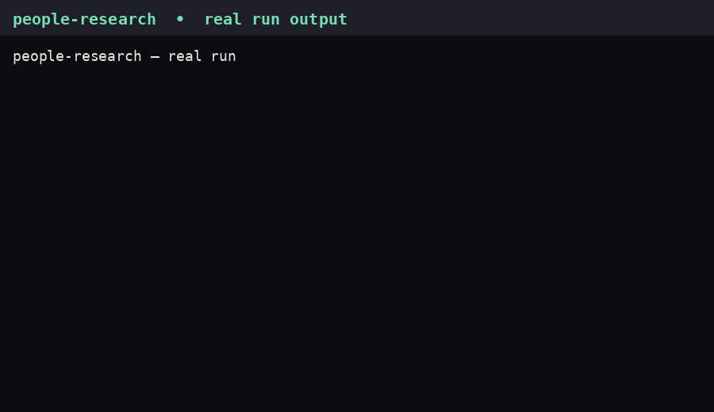

# 🔍 People Research

**Mass deep research into what real people say across social platforms, forums, videos, comments, and communities. Free. No login. No API keys. No bill.**



*The GIF above is rendered from a real run's actual output (self-tests, Reddit doctor check, a TikTok comment, and a YouTube transcript snippet), not fabricated data. 900×520, 12 frames.*

## Why this one? Benchmark

| Tool | Cost | Setup | Comments | Transcripts | Video + slides | Deep multi-topic brief | No-login core |
|---|---|---|---|---|---|---|---|
| **People Research (this repo)** | **$0, no keys** | Copy skill + free tools + self-test | YouTube, TikTok, Hacker News, Bluesky, forums, Reddit | YouTube, TikTok, Instagram, Facebook | Yes, frames + Whisper + ordered slides | Yes, cited evidence packets with dissent | Yes, with named gaps below |
| [Last 30 Days](https://github.com/mvanhorn/last30days-skill) (~65k stars) | Free core, paid after free tiers | Wizard + optional keys | Yes, via paid ScrapeCreators after free tier | Yes, via yt-dlp / paid rescue | Partial | Yes, best cited briefs | Partial (keyless tier only) |
| [Agent Reach](https://github.com/Panniantong/Agent-Reach) (~108k stars) | $0, no paid keys | `uv` + CLI + setup | Supported channels | YouTube/Bilibili subtitles | Fetch only | No, fetch only, no synthesis | Partial (X/Reddit need cookies/session) |
| Sherlock (~95k stars) | $0, no keys | 1 command | No | No | No | No, existence only | Yes |
| Maigret (~39k stars) | $0, no keys | 1 command | No | No | No | No, dossier only | Yes |
| Social Analyzer (~24k stars) | $0, no keys | Heaviest (Node/Firefox/tesseract) | No | No | No | No, profile only | Yes |

Notes on accuracy, checked Nov 4, 2026 from primary READMEs and docs:

- Last 30 Days does **not** require an X official key (optional; browser cookies or other options work). Its ScrapeCreators free tier is reported inconsistently (10,000 free calls in its README table, 100 free credits in another summary), so that exact number is **unresolved**; do not quote either as certain. Brave search is 2,000 free queries/month in its README. yt-dlp is free, not a paid tool.
- Agent Reach is free, but its own README says X and Reddit need a cookie/session, and Reddit has no zero-config path. A green `doctor` check does not mean every channel works no-login.
- Star counts are snapshots and drift. Stars measure popularity, not accuracy.

**Bottom line:** if you want one free skill that actually synthesizes what people say, with comments, transcripts, video understanding, and slides, and tells you honestly where it stops, this is it.

## 🚀 Setup (KISS)

Keep it simple. No login, no keys, no paid service.

1. Copy this repo's `SKILL.md` into your AI's skills folder, and copy `scripts/` next to it.
2. Install the free tools (use a venv; system pip may be PEP 668 externally-managed, so bare `pip install yt-dlp` can fail):

```sh
python3 -m venv ~/workspace/tools/ytdlp-env
~/workspace/tools/ytdlp-env/bin/pip install yt-dlp gallery-dl ytscrape
~/workspace/tools/ytdlp-env/bin/yt-dlp --version
pip install curl_cffi
mkdir -p ~/workspace/tools/yttranscript-npm && cd ~/workspace/tools/yttranscript-npm
npm init -y && npm install youtube-transcript
```

Local Whisper (free, cached model, offline after first download) uses `~/workspace/tools/whisper-env/bin/python` with `HF_HUB_OFFLINE=1`. ffmpeg is a system package, used for frame extraction.

3. Run the self-test:

```sh
node scripts/people-research-native.js --self-test
node scripts/transcript-batch.js --self-test
python3 scripts/reddit-arctic.py doctor
```

4. Paste the setup prompt in [SETUP_PROMPT.md](SETUP_PROMPT.md) into any AI (Muse, Grok, Duet, Dots, Aside, Claude Code, Codex) and it sets itself up completely.

## 🧠 The one rule: never stop at a block

Any AI using this skill, if it hits a block, must **not** just tell the user it is blocked and stop. It must figure out an alternative by itself and continue:

1. Retry once with backoff.
2. Try a different instance (Piped / Invidious / Redlib rotation).
3. Try a different no-key tool (yt-dlp Android, ytscrape, npm youtube-transcript, TikWM, gallery-dl, Arctic Shift, Redlib).
4. Try a different client (yt-dlp Android client, curl_cffi Chrome impersonation).
5. Download the public media and do it locally (yt-dlp + local Whisper + ffmpeg frames + vision-read slides).
6. Use search-engine indexing to find the URL, then hydrate it.
7. Use a paste-link browser tool for public URLs only.
8. Use the logged-in browser, logged in as the user.
9. Only then report what remains blocked, with partial results, exactly what was tried, and the next test.

Hard boundaries, always: never circumvent a CAPTCHA, access control, paywall, or rate/IP block with script tricks; never use another person's credentials; never send private, follower-only, or sensitive content to a third-party tool. Turnstile completing normally in-browser is allowed; script bypass is not.

## ✅ Tested capability matrix (Nov 4, 2026, real public URLs, no login, no keys)

| Platform | Discovery | Post / body | Comments | Transcript | Video understanding | Slideshows |
|---|---|---|---|---|---|---|
| YouTube | ✅ Piped search | ✅ oEmbed | ✅ Piped + yt-dlp Android | ✅ Android subs, ytscrape, npm transcript | ✅ Download + frames + Whisper | n/a |
| TikTok | ⚠️ Web-search indexing only | ✅ SSR / TikWM | ✅ TikWM top-level | ✅ Native VTT, fbtotranscript, local Whisper | ✅ Download + frames + Whisper | ⚠️ gallery-dl / TikWM, post-dependent |
| Instagram | ⚠️ Embed per post only | ✅ Embed caption | 🔐 Session only | ✅ fbtotranscript / local Whisper | ✅ Download + frames + caption | ✅ Embed, order assumed = app order |
| Facebook | 🔐 Session only | 🔐 Session only | 🔐 Session only | ✅ On a supplied URL: yt-dlp auto-subs, fbtotranscript, Whisper | ✅ On a supplied URL | 🔐 Session only, ordered |
| Threads | ✅ First page, curl_cffi | ✅ curl_cffi | ✅ First batch only | ✅ SSR mp4 + Whisper | ✅ SSR mp4 + Whisper | n/a |
| X | ❌ Keyword search | ✅ oEmbed | ✅ First page, FxTwitter conversation | n/a | n/a | n/a |
| LinkedIn | ✅ Web-search indexing | ✅ Embed | ❌ Full threads; counts via title ✅ | n/a | n/a | n/a |
| Reddit | ✅ Arctic scoped + Redlib global | ✅ Arctic / Redlib | ✅ Arctic / Redlib | n/a | n/a | n/a |
| Bluesky, Hacker News, forums | ✅ | ✅ | ✅ | n/a | n/a | n/a |

Caveats, stated plainly:

- **TikTok slideshows are post-dependent.** One test post gave 7 ordered slides on both routes; a different public post failed both (TikWM parsing failed, gallery-dl "post not available"). Fall back to a paste-link tool or the logged-in browser, never claim a post is unavailable from one route alone.
- **TikWM** advertises about 300 req/month free; anonymous requests worked on test day, availability is not guaranteed.
- **Redlib:** only `safereddit.com` worked out of 6 hosts tried that night. Reddit RSS ends Nov 13, 2026 and the public Data API ends Mar 2027; Redlib is the durable route. Never rank by an Arctic fresh score (fresh posts read score 1, 0 comments).
- **FxTwitter / Threads:** first page only. Pagination and full reply trees need a browser or login.
- **YouTube yt-dlp:** the Android client is the only one that downloads subtitles. `--max-comments` does not exist in yt-dlp 2026.10.26; truncate `.info.json` post-hoc.

## 🔐 What still needs a manual login or browser

After a wide sweep (about 68 web queries, 169 repo/tool entries, plus a paste-link sweep), no no-login route was found for: TikTok search and nested replies; Instagram comment bodies and native transcripts; Facebook posts, comments, discovery, and ordered slides; Threads pagination and full trees; X keyword search and full trees; LinkedIn full threads; Saveto end to end.

For those, the skill's setup tells the user plainly: log in in the AI's own browser, as yourself, and let the AI read the rendered page. No credentials are stored, no tokens are pasted into logs, and no private content goes to a third-party tool.

## 🌐 Paste-link browser tools (last fallback, before login)

These are **docs-claimed, not live-browser-verified** unless marked otherwise. A live-browser paste test is still queued: open the tool, paste a known public URL, submit, let Turnstile complete in-browser, copy the rendered result. Do not claim any of these works via curl. Never paste private content into them.

| Still-blocked item | Paste-link tool (docs-claimed) |
|---|---|
| TikTok nested replies | TikSaveHub, ZocialComment, CommentTok, ExportTok, Adlicio comment viewer |
| TikTok slideshows (when gallery-dl/TikWM fail) | TTViewer, TikRapid, SnapTik family, Klipa |
| Instagram comments | ZocialComment, Adlicio, Giveaway Ninja (picker, up to 100), ExportComments |
| Instagram transcripts | InstaScript, InstagramTranscripts.com, TranscriptClip, Supadata web form |
| Facebook comments | ExportComments (free up to 100/post), FreeCommentPicker, ZocialComment |
| Facebook slides / posts | TweetMediaArchive (carousel ZIP), ClipsSaver (single photos only) |
| Facebook / Threads / X transcripts | Supadata web form, TranscriptClip, ScreenApp (free plan 2×45 min), GetTheScript, TokScript |
| Threads full trees | ThreadsTools, ZocialComment Threads exporter, Adlicio Threads viewer |
| X search / full trees | GetXAPI viewer, UnifAPI viewer, FinchView, Postel (1 free search/day), TwitterViewer.app |
| LinkedIn full threads | Adlicio LinkedIn viewer, GetSendable, Connie (commenters list) |
| Saveto end to end | Saveto itself, browser-form only (its API is Turnstile-gated, not a curl route) |

No free tool in this list guarantees a complete nested thread; most free tiers cap at 100 comments.

## 📁 What's in this repo

- `SKILL.md` — the full skill, with platform commands, fallback ladders, and test evidence.
- `scripts/` — `people-research-native.js`, `transcript-batch.js`, `x-hydrate-batch.js`, `linkedin-hydrate-batch.js`, `youtube-transcript-batch.py`, `reddit-arctic.py`, `local-video-transcribe.py`.
- `SETUP_PROMPT.md` — copy-paste prompt for any AI.
- `demo.gif` — real-run demo.
- `CONTRIBUTING.md` — how to add a route without breaking the free, no-key rule.

## ⚠️ Scope and privacy

Public content only. Never use this skill for private, follower-only, or sensitive content, and never use it with paid APIs, scraped credentials, or CAPTCHA/paywall bypasses unless you explicitly change that rule yourself. Pinterest and Rumble are out of default scope; arXiv, Douyin, Xiaohongshu, and Bilibili are excluded unless explicitly requested.

License: MIT. See [LICENSE](LICENSE).
